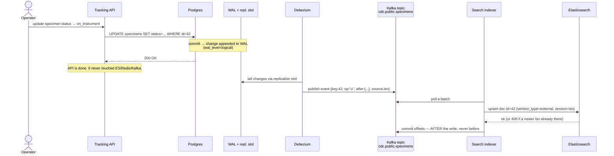
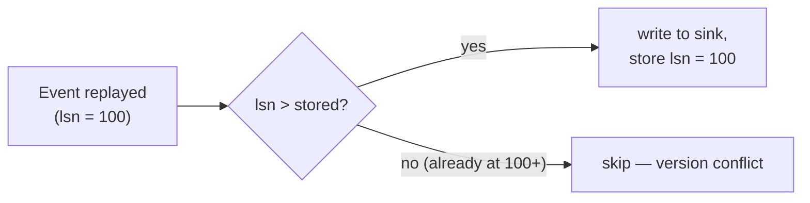
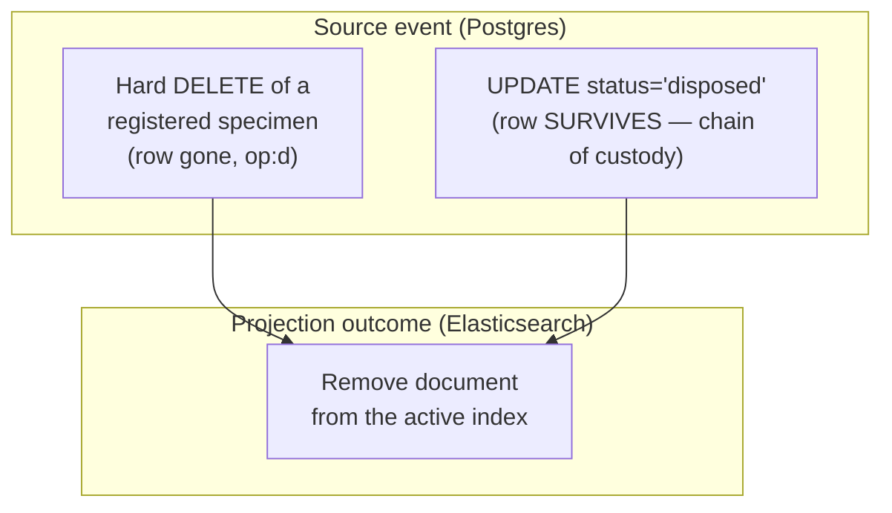
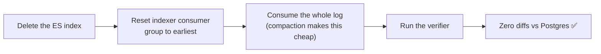

# Data lifecycle — the journey of one change

> **Status:** current (pipeline stages land across epics 02–05) · **Spec:**
> [ARCHITECTURE.md](../ARCHITECTURE.md) §5–§7

The [overview](overview.md) shows the parts. This page follows a *single change* all the
way through them, because the ordering of a few steps is where correctness lives.

## The happy path: an operator updates a specimen

Three things in that diagram carry the whole design:

1. **The API stops after Postgres.** One write, one transaction. Everything downstream is
   someone else's job, happening asynchronously. This is what makes the producer ignorant
   and the system extensible.
2. **`version = source.lsn`.** Every event carries its position in the WAL (the LSN, a
   monotonically increasing number). The indexer writes to Elasticsearch *with that version*,
   so if an older event is ever replayed, Elasticsearch rejects it with a version conflict.
   Idempotency is enforced by the sink itself, not by fragile bookkeeping.
3. **Commit offsets AFTER writing to the sink.** If the consumer crashes between writing and
   committing, the event is redelivered — and the version guard absorbs the duplicate.
   Committing *before* writing would turn a crash into silent data loss. This single
   ordering rule is the most important line in every consumer.

## Why duplicates are normal (and fine)

The whole pipeline is **at-least-once**. Debezium can re-emit from its last acknowledged
LSN after a restart; a consumer can crash mid-batch; a rebalance can redeliver in-flight
messages. So duplicates *will* happen — and every consumer is built to not care:

- **Elasticsearch:** `version_type=external`, `version=lsn` → older replays lose the 409.
- **Redis:** value stored with its LSN; a Lua compare-and-set rejects writes whose LSN is
  ≤ the stored one.

## Two changes that look different but mean the same thing

Deletes are where the read-model and the source *decouple* — the interesting part
([ARCHITECTURE.md §3, §7](../ARCHITECTURE.md)):

A hard delete (a mis-accessioned specimen physically removed) and a soft delete (a
`disposed` specimen that is *never* physically deleted, only marked) are two completely
different source events — but both must **remove the document from the active search
index**. "Delete in the source" and "delete in the read-model" are not the same operation,
and the indexer maps both onto the projection-delete. This is exactly the kind of thing
tutorials skip and production systems get wrong.

## The cross-topic join problem (a teaser)

The specimen search document embeds fields from its *run* (`sequencer`, `assay_protocol`,
`operator`) — but run changes arrive on a **different topic** with no ordering relationship
to specimen changes. So a specimen event can arrive before its run is known, and a
sequencer re-assignment must fan out to re-index every specimen in that run. How the
indexer handles this (local run lookup, `_pending_enrichment`, update-by-query) is its own
story — see [ARCHITECTURE.md §7](../ARCHITECTURE.md) and the (planned) search-indexer wiki
page.

## Rebuild: the payoff

Because every derived store is a function of the log, any of them can be thrown away and
rebuilt:

Compaction (latest-per-key) is what makes offset-0 replay affordable, and the verifier is
what makes "in sync" a program's verdict rather than a human's impression. Details in
[ARCHITECTURE.md §6](../ARCHITECTURE.md).
