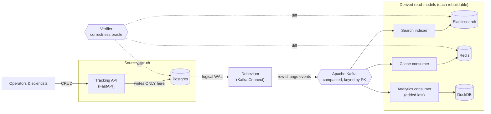
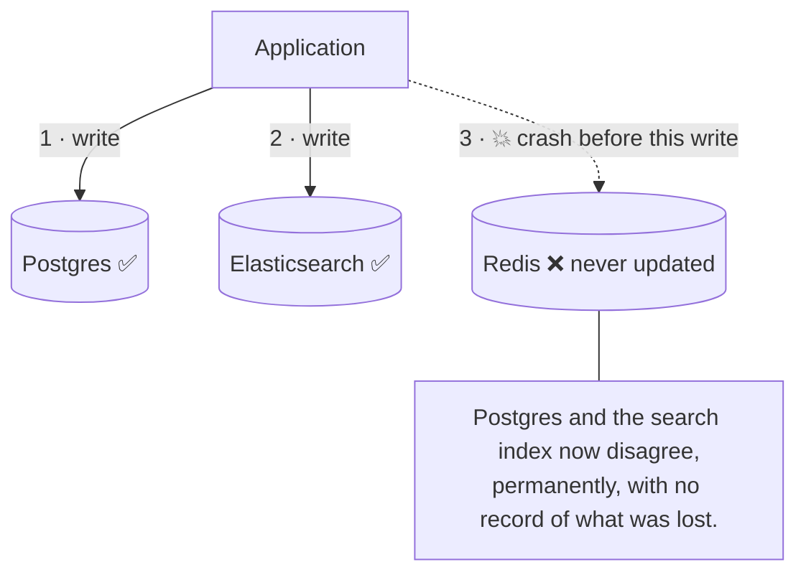
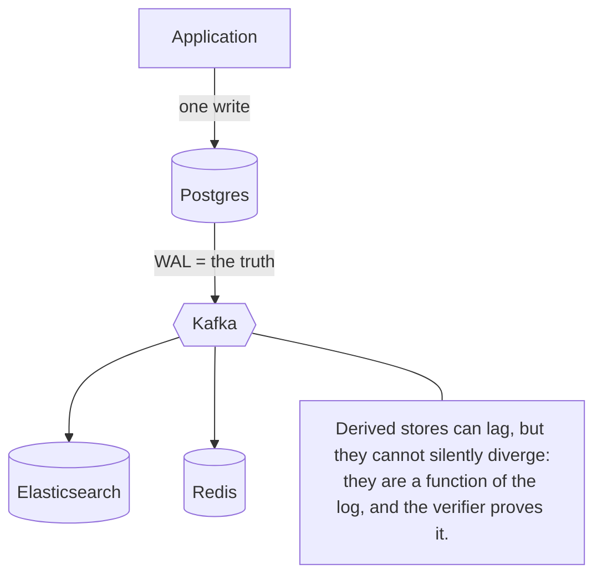

# System overview

> **Status:** current · **Spec:** [ARCHITECTURE.md](../ARCHITECTURE.md) §1–§2

This page is the one-picture mental model of the whole system: what each part does, how a
change flows through it, and — most importantly — *why the design looks like this at all.*

## The one-sentence version

> A genomic sequencing platform writes specimen and run state to **Postgres**, and every
> other data store (a search index, a cache, later an analytics store) is **derived from
> Postgres's change log** rather than written to directly — so they can never silently
> drift, and any of them can be rebuilt from the log on demand.

## The whole pipeline

Read it left to right: writes go to Postgres and **only** Postgres; Debezium tails
Postgres's write-ahead log and publishes each row change to Kafka; each derived store has
its **own** consumer reading the log independently; the verifier proves they all still
agree with Postgres.

The tracking API is deliberately **boring and ignorant** — it does not know Elasticsearch,
Redis, or Kafka exist. That ignorance is the whole point: adding the analytics consumer
later requires *zero* changes to the producer.

## Why derive everything? The dual-write problem

The tempting naive design is to have the application write to each store itself. It is
broken, because **no transaction spans Postgres and Elasticsearch**:

A crash (or a network blip, or a bug) between writes leaves the stores permanently
inconsistent — and nothing even *knows*. In a regulated genomics lab, "the specimen search
quietly disagrees with the system of record" is a chain-of-custody defect, not a cosmetic
bug.

The CDC design removes the second and third writes entirely. There is exactly **one**
write — to Postgres — and its durable write-ahead log becomes the single source every other
store is derived from:

The stores may be briefly *behind* (the pipeline is asynchronous), but they cannot be
*wrong* — they are a deterministic function of the same log, and any of them can be deleted
and rebuilt from offset zero. That rebuild, verified by an automated diff, is the demo that
proves the whole thesis.

## Why this scale needs it (and isn't over-engineering)

At one lab's volume (a few thousand specimens) Postgres alone would serve search, reads,
and analytics — this stack would be overkill. The design targets a **biobank / national
programme** holding *millions* of specimens, where programme-wide search and analytics
genuinely cannot run against the governed clinical OLTP database without threatening the
write path that runs the lab. So the read-model is justified twice: by **correctness**
(dual-write, above — true at any volume) and by **scale** (read/query-shape load must leave
the source of truth alone). See [ARCHITECTURE.md](../ARCHITECTURE.md) intro.

## What each part is (and where to read more)

| Part | One line | Deep page |
|---|---|---|
| Tracking API | Boring CRUD on runs/specimens; the only writer to Postgres. | [Tracking service](pipeline/tracking-service.md) |
| **Postgres** | Source of truth; emits a logical change stream off its WAL. | [Postgres & CDC](platform/postgres-and-cdc.md) |
| **Debezium / Connect** | Tails the WAL, publishes row changes to Kafka. | [Kafka Connect + Debezium](platform/kafka-connect-debezium.md) |
| **Kafka** | Durable, ordered, replayable log; compacted, keyed by PK. | [Apache Kafka](platform/kafka.md) |
| Search indexer | Change events → denormalized Elasticsearch documents. | [Search indexer](pipeline/search-indexer.md) |
| Cache consumer | Change events → Redis entries. | [Cache consumer](pipeline/cache-consumer.md) |
| Analytics consumer | Change events → DuckDB facts (added last — the fan-out proof). | [Verifier & replay](pipeline/verifier-and-replay.md) |
| Verifier | Automated Postgres ↔ ES ↔ Redis diff — the definition of "in sync." | [Verifier & replay](pipeline/verifier-and-replay.md) |

## What this is deliberately NOT

- **Not an audit trail.** It derives *current state*, not append-only history — that's event
  sourcing, a different pattern. Our topics are compacted (latest-per-key).
- **Not the raw sequence-data firehose.** The base-call/FASTQ/BAM stream off the sequencers
  is a separate stream-processing problem. This tracks specimen/run *state*.

Both boundaries are explained in [ARCHITECTURE.md §0](../ARCHITECTURE.md).
