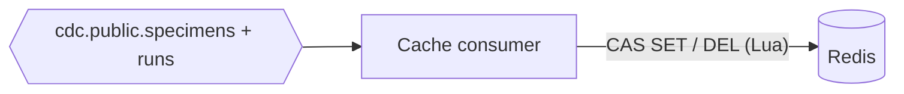
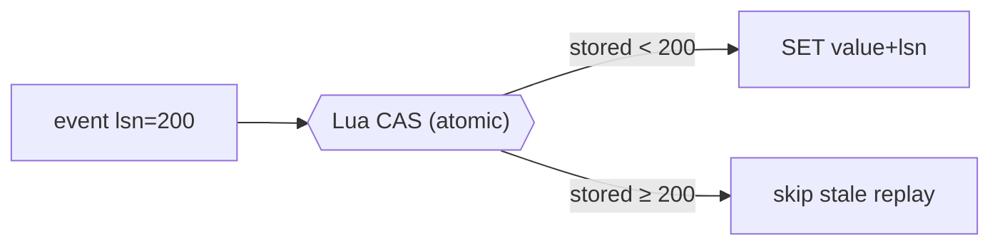

# Cache consumer

> **Status:** 📐 planned — [epic 05](../../project-mgmt/epic-05-cache-consumer/) · **Spec:**
> [ARCHITECTURE.md](../../ARCHITECTURE.md) §5, D7

The cache consumer keeps Redis in sync with Postgres — the simpler sibling of the search
indexer (no cross-topic join, no denormalization), which makes it the clean place to see the
idempotency pattern on a store that has no built-in versioning.

## Role

## CAS idempotency and deletes (story 05.2)

Elasticsearch enforces idempotency itself via external versioning; Redis can't, so the
consumer does it explicitly with an atomic **Lua compare-and-set**: a write lands only if its
`source.lsn` exceeds the LSN stored with the current value; deletes use the same guard. This
is the same guarantee as the indexer, implemented by hand — see
[Redis](../platform/redis.md#idempotency-compare-and-set-on-the-lsn).

Commit offsets **after** the write, as everywhere ([data lifecycle](../data-lifecycle.md)).

## Parity and the read path (story 05.3)

The consumer's whole purpose is parity with Postgres. The **verifier** diffs Redis against
the source by key and content hash ([epic 06](verifier-and-replay.md)); a demonstrated read
path shows point reads served from Redis instead of the OLTP database — the scale argument
made concrete.

## See also

- [Redis](../platform/redis.md) — the sink and its CAS model
- [Search indexer](search-indexer.md) — the same idempotency idea, harder sink
- [Verifier & replay](verifier-and-replay.md) · [Data lifecycle](../data-lifecycle.md)
