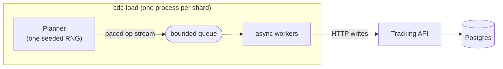

# Load generator (`cdc-load`)

> **Status:** built (story 02.3) — [epic 02](../../project-mgmt/epic-02-source-service/) ·
> **Spec:** [ARCHITECTURE.md](../../ARCHITECTURE.md) §2, §7 · **Code:**
> [src/cdc_pipeline/tools/load/](../../src/cdc_pipeline/tools/load/) ·
> **Decisions:** [ADR 0004](../adr/0004-write-path-load-tuning.md) ·
> [learnings 04](../../learnings/04-load-generation-and-workload-modeling.md)

`cdc-load` is an async, open-loop write-load generator that drives the **tracking API**
(never Postgres directly — ARCHITECTURE.md §2), so the load exercises the same write path
production traffic would. It is the workhorse the later epics reuse to test idempotency
under redelivery (04), rebalance safety (05), and rebuild time (06–07): without sustained,
*realistic* load those claims are untested.



## What it does

- **Async workers driving the API.** A pacer issues operations at a target rate; a bounded
  queue feeds `--concurrency` workers that POST/PATCH/DELETE against the API.
- **Configurable mix** (default **70%** specimen update / **15%** insert / **10%** dispose /
  **5%** registered hard-delete). Specimen updates **walk the status lifecycle**
  (`registered → in_prep → on_instrument → completed`) so events look like real lab
  throughput.
- **Zipfian key selection** for updates and runs — a hot set of specimens/runs takes most of
  the traffic, which is what makes per-key ordering and cache behavior interesting downstream
  (uniform load hides both).
- **Reproducible** via `--seed`: the op-kind stream, key skew, and rate profile repeat
  exactly. See the reproducibility contract in
  [learnings 04](../../learnings/04-load-generation-and-workload-modeling.md).
- **Live readout** (achieved req/s, error rate, p50/p99) and a **final summary block** built
  for pasting into field notes.

## Scenarios

| Scenario | Shape | What it stresses |
|---|---|---|
| `steady` | default mix at N/s, constant | the baseline; the 1k/s acceptance target |
| `delete-wave` | ~48% inserts / ~48% registered hard-deletes | tombstone pressure for the epic-04 consumers |
| `reassignment-storm` | 35% run re-assignments/amendments on **hot** runs + 65% specimen updates | the §7 denormalization fan-out (one run write ⇒ re-index all its specimens) |
| `burst` | steady mix with **10× rate spikes** | consumer lag becomes visible when the API briefly outruns downstream |

## Running it

```bash
make load                                   # steady, RATE=1000, DURATION=60, from the host
make load SCENARIO=burst RATE=200 DURATION=120
make load SCENARIO=reassignment-storm RATE=300 SEED=7

# Or directly, with the full flag set:
uv run cdc-load steady --rate 1000 --duration 300 --concurrency 48 --seed 3
uv run cdc-load steady --rate 500 --ramp-to 2000   # ramp to find the knee
uv run cdc-load steady --mix "update=80,insert=20" # override the mix
```

Key flags: `--rate` (target req/s), `--duration`, `--concurrency` (workers/proc), `--seed`,
`--processes` (client processes across cores; rate is split among them), `--ramp-to`,
`--mix`, `--api-url`, `--pool-size`. Full list: `uv run cdc-load --help`.

## Results & expectations

Numbers from this repo's compose stack (Apple Silicon, 12 cores, Docker Desktop for Mac),
after the tuning in [ADR 0004](../adr/0004-write-path-load-tuning.md):

| Measurement | Value | Notes |
|---|---|---|
| API server-side latency under load | **p50 ~5 ms, p99 ~9 ms** | from the API's own request log — the API is *not* the bottleneck |
| Single host client (`--processes 1`) | **~420–570 req/s, 0 errors** | the reliable default on macOS |
| In-container client (no host proxy) | **800+ req/s** aggregate | two shards, same API |
| Postgres CPU under 1k/s attempt | **~6–20%** | never the limit once tuned |

**Reading the summary.** `requests`/`achieved req/s` is throughput; `errors` must stay
<0.1% (the process exits non-zero if it doesn't, so `make load`/CI can gate on it);
`skipped` counts drawn ops with no eligible target (e.g. a hard-delete when the registered
pool is momentarily empty) — those are *not* errors and don't touch the API.

### The one caveat worth knowing

On **Docker Desktop for Mac**, the host→container port proxy — not the API — caps a
host-run generator to a few hundred req/s, and firing several client processes at it storms
bootstrap and stalls. That's why `PROCESSES` defaults to `1` here. The tuned stack genuinely
serves each write in ~5 ms and is capable of the full **1,000 writes/s**; to demonstrate
that end-to-end, run the generator where there is no host-proxy hop:

- a **Linux Docker host / CI** (`--processes 3–6` scales cleanly there), or
- **in-network**, pointing at the container address, e.g.
  `--api-url http://api:8000` from a container on the compose network.

This is a property of the local dev *harness*, not of the API, Postgres, or the generator.
The full investigation — and why the API was never the slow part — is in
[learnings 04](../../learnings/04-load-generation-and-workload-modeling.md).

## Tuning that made this work (story 02.3)

- **API:** multiple uvicorn workers (`API_WORKERS`, default 4) for real parallelism past the
  single-process GIL ceiling; DB pool sized above the request-thread count (`DB_POOL_SIZE` /
  `DB_MAX_OVERFLOW`).
- **Postgres:** `synchronous_commit=off` (no per-COMMIT WAL fsync — safe for CDC, the WAL is
  still flushed so Debezium captures everything) and `max_connections=200` for the pools.

See [ADR 0004](../adr/0004-write-path-load-tuning.md) for the full rationale and alternatives.
