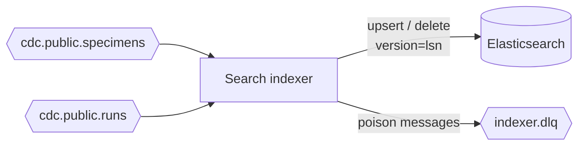
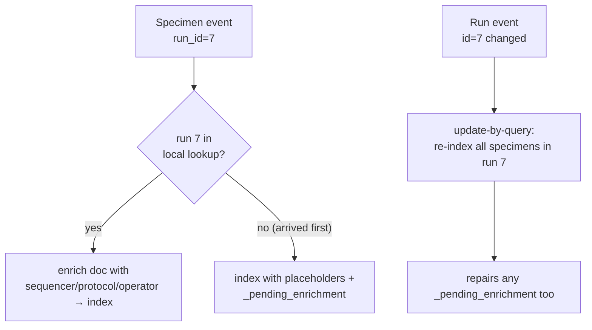

# Search indexer

> **Status:** 📐 planned — [epic 04](../../project-mgmt/epic-04-search-indexer/) · **Spec:**
> [ARCHITECTURE.md](../../ARCHITECTURE.md) §5, §7, D5, D7

The search indexer consumes change events and maintains the Elasticsearch specimen index.
It's the **hardest consumer** in the system, because search wants *denormalized* documents
and the source data arrives *normalized across two unordered topics*.

## Role

## Idempotent upserts and deletes (story 04.2)

Every write to Elasticsearch uses `version_type=external, version=source.lsn`, so replays of
older events lose the version conflict and are skipped — idempotency enforced by the store.
Offsets are committed **after** the write, never before. Both projection-deletes (hard
`DELETE`, and `disposed` soft-delete) map to "remove from index." See
[Elasticsearch](../platform/elasticsearch.md#the-one-hard-requirement-external-versioning)
and [data lifecycle](../data-lifecycle.md).

## The cross-topic join (story 04.4 — the crux)

Specimen documents embed run fields, but run changes are on a different topic with **no
ordering relationship** to specimen changes:

- **Local run lookup** (`id → {sequencer, assay_protocol, operator, lsn}`) built from the
  runs topic, used to enrich specimen docs.
- **Specimen-before-run:** enrich with placeholders + `_pending_enrichment`; the run event
  repairs it. Never block the partition waiting.
- **Sequencer re-assignment / protocol amendment:** fan out via **update-by-query**
  ([D5](../../ARCHITECTURE.md)) — bounded work, no offset gymnastics. Trade-off: the indexer
  touches the sink outside the per-event path; the verifier keeps it honest.

## Batching and backpressure (story 04.3)

Poll a batch, bulk-write to Elasticsearch, then commit — throughput without losing the
commit-after-write guarantee. Backpressure comes naturally from not polling the next batch
until the current one is durably written.

## Retries and DLQ (story 04.5)

A **poison message** (deserialization failure, mapping bug) must never block its partition
forever *or* be silently dropped. After bounded retries it goes to `indexer.dlq` with error
metadata; a replayer tool re-injects it after a fix ([ARCHITECTURE §5](../../ARCHITECTURE.md)).

## Client choice

Consumers use **`confluent-kafka`** (librdkafka) for manual commit control and
production-grade behavior over the thinner asyncio clients ([D7](../../ARCHITECTURE.md)).

## See also

- [Elasticsearch](../platform/elasticsearch.md) — the sink and its versioning model
- [Verifier & replay](verifier-and-replay.md) — proves the index matches Postgres
- [Data lifecycle](../data-lifecycle.md) · [System overview](../overview.md)
