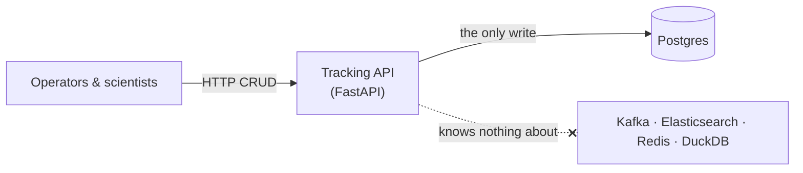

# Tracking service

> **Status:** 📐 planned — [epic 02](../../project-mgmt/epic-02-source-service/) · **Spec:**
> [ARCHITECTURE.md](../../ARCHITECTURE.md) §2, §3

The tracking service is the **only writer to Postgres** — a boring FastAPI app doing CRUD on
runs and specimens. Its defining feature is what it *doesn't* do.

## The point: deliberate ignorance

The API has **no knowledge** that Kafka, Elasticsearch, Redis, or any consumer exists. It
writes to Postgres and returns. That ignorance is the architectural payoff: when the analytics
consumer is added in epic 06, the producer needs **zero changes** — the proof that CDC truly
decouples producers from consumers.

## Planned shape

- **Endpoints:** CRUD for `runs` and `specimens` — create/read/update, plus the two
  domain-authentic deletes (hard delete of a `registered` specimen; disposal as an `UPDATE`
  to `status='disposed'`). See the [data model](../platform/postgres-and-cdc.md#data-model-whats-being-captured).
- **Persistence:** SQLAlchemy / psycopg against Postgres; `NUMERIC(10,2)` for `volume_ul`
  handled as `Decimal`, never float ([D6](../../ARCHITECTURE.md)).
- **Schema & migrations** (story 02.1): tables, constraints, and the
  `REPLICA IDENTITY FULL` that CDC needs ([learnings/01](../../learnings/01-postgres-logical-replication.md)).
- **Load generator** (story 02.3): a configurable write workload *against the API* (never
  bypassing it) to drive the pipeline for demos and chaos drills.

## Why it matters here

Everything downstream is a function of what this service writes. Its correctness is simple
(ordinary CRUD), but its **boundaries** are the interesting design: one writer, one store, no
downstream awareness. Keep it boring on purpose.

## See also

- [Postgres & CDC](../platform/postgres-and-cdc.md) — the store it writes to
- [System overview](../overview.md) · [Data lifecycle](../data-lifecycle.md)
