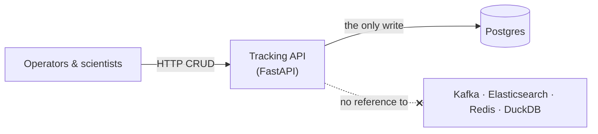

# Tracking service

> **Status:** built (story 02.2) — [epic 02](../../project-mgmt/epic-02-source-service/) ·
> **Spec:** [ARCHITECTURE.md](../../ARCHITECTURE.md) §2, §3 · **Code:**
> [src/cdc_pipeline/api/](../../src/cdc_pipeline/api/)

The tracking service is a FastAPI application providing CRUD over sequencing `runs` and
their `specimens`. It is the only component that writes to Postgres, and it writes nothing
else: it has no client for, and no reference to, Kafka, Elasticsearch, Redis, or any
downstream consumer.



This decoupling is a design constraint rather than an incidental one: derived stores are
built from Postgres's change stream, so a new consumer (for example the analytics consumer
in epic 06) is added without modifying this service. The constraint is verifiable —
`grep -riE "kafka|redis|elasticsearch" src/cdc_pipeline/api/` returns nothing.

## Endpoints

| Method & path | Effect |
|---|---|
| `POST /runs`, `GET /runs`, `GET /runs/{id}` | create, list (filters: `status`, `sequencer`), fetch |
| `PATCH /runs/{id}` | partial update, including `sequencer` re-assignment and `assay_protocol` amendment (§7) |
| `POST /specimens`, `GET /specimens`, `GET /specimens/{id}` | create, list (filters: `status`, `run_id`, `assay`, `specimen_type`), fetch |
| `PATCH /specimens/{id}` | partial update of a specimen's fields |
| `POST /specimens/{id}/dispose` | set `status='disposed'` (an `UPDATE`; the row is retained) |
| `DELETE /specimens/{id}` | physically remove a `registered` specimen; `409` for any other status |
| `GET /health` | liveness plus a database-reachability check |

Interactive API documentation (Swagger UI) is served at `/docs` and OpenAPI JSON at
`/openapi.json`.

### Specimen lifecycle and the two delete paths

A specimen moves through `registered → in_prep → on_instrument → completed`, with `disposed`
as a terminal state reachable from any of them. Two transitions map to a removal in the
downstream search projection, from two different source events (ARCHITECTURE.md §3, §7):

- **Hard delete** (`DELETE /specimens/{id}`) physically removes the row and is permitted
  only while the specimen is `registered` — for example a specimen accessioned in error, or
  a control specimen never committed to a run. Postgres emits a delete and a tombstone.
  A specimen in any later status is a chain-of-custody record and cannot be hard-deleted;
  the request is rejected with `409`.
- **Disposal** (`POST /specimens/{id}/dispose`) is an `UPDATE` to `status='disposed'`. The
  source row is retained; the search projection removes the document regardless.

## Persistence

SQLAlchemy Core/ORM over psycopg (v3), with one session and one transaction per request.
`volume_ul` is `NUMERIC(10,2)` in Postgres, carried as `Decimal` end to end and serialised
to a JSON string to preserve its exact value ([D6](../../ARCHITECTURE.md)). The schema, its
CHECK constraints, and the `REPLICA IDENTITY FULL` required for CDC are defined by the
migrations in story 02.1 ([learnings/01](../../learnings/01-postgres-logical-replication.md)).

## Running it

```
make up      # start the stack (Postgres, Kafka+Connect, Elasticsearch, Redis, kafka-ui, tracking API)
make seed    # apply migrations and load sample data (~30 runs, ~5k specimens); idempotent
make api     # optional: run the API from source with auto-reload, instead of the container
```

The API listens on `http://localhost:8000` (configurable via `API_PORT`). Example requests
are in [`requests.http`](../../requests.http). Integration tests run against the compose
Postgres with `make itest` (after `make up` and `make seed`).

The database must be migrated before the API can serve `runs` or `specimens`; requests
against an unmigrated database return `500`. `make nuke` removes the Postgres volume, so a
subsequent `make up` starts with an empty database — run `make seed` again before use. The
`api` container's healthcheck verifies database connectivity only, not that migrations have
been applied.

## Write-latency baseline

Recorded 2026-07-12: 300 sequential `POST /specimens` requests from a local `httpx` client
against the app and the compose Postgres over loopback, single connection, no concurrency.
These figures are a low-contention baseline for later comparison (concurrent load in story
02.3; degradation under the failure drills in epic 07), not a throughput measurement.

| request | p50 | p95 | p99 | mean |
|---|---|---|---|---|
| `POST /specimens`, end to end (ms) | 2.8 | 3.8 | 4.7 | 2.9 |

## See also

- [Postgres & CDC](../platform/postgres-and-cdc.md) — the store it writes to
- [System overview](../overview.md) · [Data lifecycle](../data-lifecycle.md)
