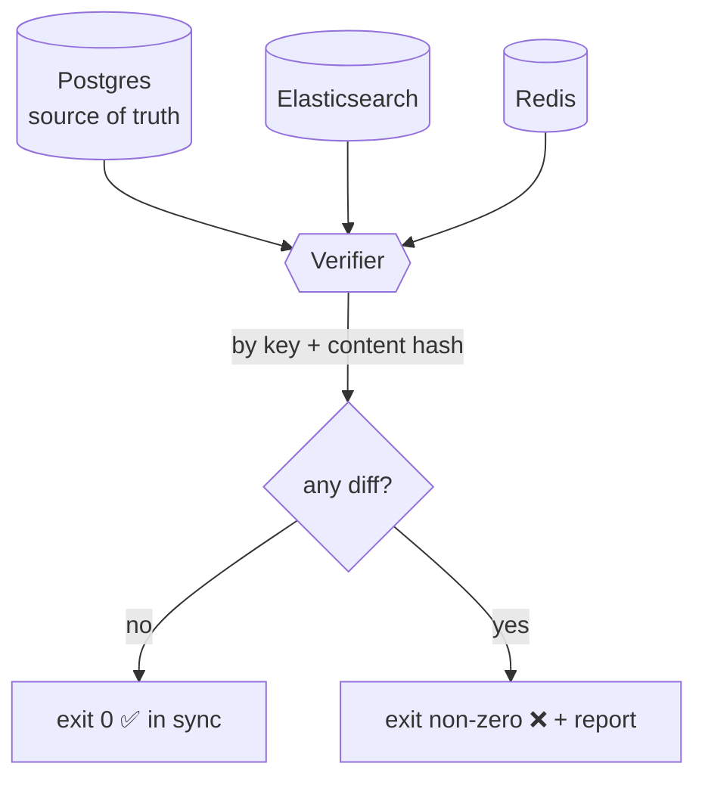
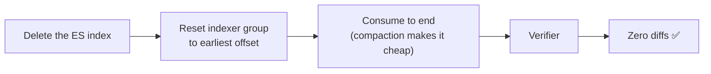
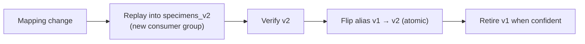
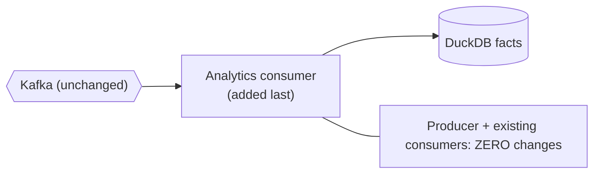

# Verifier & replay

> **Status:** 📐 planned — [epic 06](../../project-mgmt/epic-06-replay-and-fanout/) · **Spec:**
> [ARCHITECTURE.md](../../ARCHITECTURE.md) §6, D3

This is where the whole design pays off. The **verifier** makes "in sync" a program's verdict,
and **replay** proves any derived store can be rebuilt from the log. Together they turn the
CDC thesis from a claim into a demo.

## The verifier: the correctness oracle

The verifier diffs full Postgres state against each derived store — **by key and by content
hash** — and exits non-zero on any discrepancy. It is not optional tooling; it *is* the
definition of "in sync," and it's the assertion at the end of every chaos drill (epic 07).
"The stores agree" is never a human's impression.

## Rebuild from log (story 06.2)

Delete the entire Elasticsearch index, reset the consumer group to offset 0, let it rebuild,
and the verifier confirms it matches Postgres exactly. **Compaction** (latest-per-key,
[D3](../../ARCHITECTURE.md)) is what makes offset-0 replay affordable — see
[Kafka](../platform/kafka.md#log-compaction-bounded-but-never-forgets-current-state).

## Zero-downtime reindex (story 06.3)

The production pattern for "the derivation logic changed": build the new index alongside the
old, verify, then flip an Elasticsearch **alias** atomically — no maintenance window. See
[Elasticsearch](../platform/elasticsearch.md#zero-downtime-reindex-epic-06).

## Analytics fan-out (story 06.4): the late-arrival proof

Adding a brand-new DuckDB analytics consumer **after** everything else — with no change to the
producer or the other consumers — is the concrete proof that the log truly decouples
producers from consumers. Its late arrival is the whole point.

## See also

- [Search indexer](search-indexer.md) · [Cache consumer](cache-consumer.md) — what it verifies
- [Kafka](../platform/kafka.md) — compaction, the thing that makes replay cheap
- [System overview](../overview.md) · [Data lifecycle](../data-lifecycle.md)
