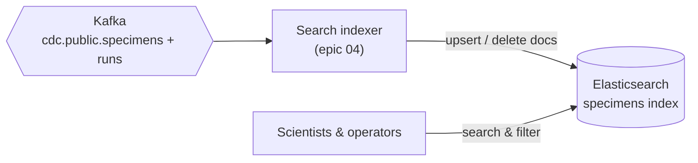
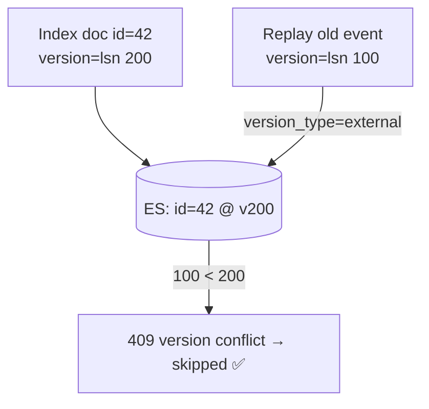

# Elasticsearch

> **Status:** running; **empty until the indexer lands** (epic 04) · **Spec:**
> [ARCHITECTURE.md](../../ARCHITECTURE.md) §2, §5, §7, D8 · **REST:** <http://localhost:9200>

Elasticsearch is the **search read-model** — the store that answers programme-wide specimen
search (full-text over labels/descriptions, filter by assay / sequencer / status / run)
without any of it touching the governed Postgres OLTP database.

## Role



It's populated **only** by the search indexer consuming Kafka — never written to by the
application directly. Today the cluster is up and healthy but holds no specimen index; that
index appears when [epic 04](../../project-mgmt/epic-04-search-indexer/) builds the indexer.

## Single node, security disabled

We run one node with `discovery.type=single-node` and `xpack.security.enabled=false` — a
local lab, no auth/TLS ([ARCHITECTURE §9](../../ARCHITECTURE.md)). Heap is pinned small
(`-Xms512m -Xmx512m`) so it coexists with Kafka and Postgres. Check it:

```bash
curl -s http://localhost:9200/_cluster/health | jq .status   # → green
```

## The one hard requirement: external versioning

Elasticsearch is chosen over OpenSearch for recognition, but the design's single hard
requirement is **external versioning** — supported identically by both, so the choice is
architecturally free ([D8](../../ARCHITECTURE.md)).

Here's why it's non-negotiable. The pipeline is at-least-once, so the indexer *will*
sometimes replay an older event after a newer one. External versioning makes the store itself
reject the stale write:



The indexer writes each document with `version_type=external, version=<source.lsn>`. A
replayed older event loses the version check and is silently skipped — **idempotency enforced
by Elasticsearch**, not by bookkeeping in the consumer. Deletes use the same guard (versioned
delete). See [data lifecycle](../data-lifecycle.md#why-duplicates-are-normal-and-fine).

## Denormalized documents (the interesting part)

The specimen document **embeds run fields** (`sequencer`, `assay_protocol`, `operator`)
because search wants denormalized docs — "all specimens on sequencer SEQ-07". But runs and
specimens arrive on *different topics* with no ordering guarantee, so:

- the indexer keeps a local **run lookup** to enrich specimen docs;
- a specimen seen before its run is enriched with placeholders and marked
  `_pending_enrichment`, repaired when the run event arrives;
- a **sequencer re-assignment** re-indexes every specimen in that run via an
  **update-by-query** ([D5](../../ARCHITECTURE.md)).

This cross-topic join is the hardest real problem in search-index sync — it gets its own deep
page ([search indexer](../pipeline/search-indexer.md)) and [ARCHITECTURE §7](../../ARCHITECTURE.md).

## Projection-deletes

Two different source events must both **remove a document** from the active index: a hard
`DELETE` of a `registered` specimen, and an `UPDATE` to `status='disposed'` (whose source row
*survives*). "Delete in the source" ≠ "delete in the read-model" — see
[data lifecycle](../data-lifecycle.md#two-changes-that-look-different-but-mean-the-same-thing).

## Zero-downtime reindex (epic 06)

When the document mapping changes, we don't mutate in place: we replay the log into a **new
index** (`specimens_v2`) under a new consumer group, verify it, then flip an **alias** from
v1 to v2 atomically. "Reindex without a maintenance window" is a real operational win in a
regulated lab — [ARCHITECTURE §6](../../ARCHITECTURE.md) and
[verifier & replay](../pipeline/verifier-and-replay.md).

## See also

- [Search indexer](../pipeline/search-indexer.md) — the consumer that populates this store
- [Data lifecycle](../data-lifecycle.md) · [System overview](../overview.md)
