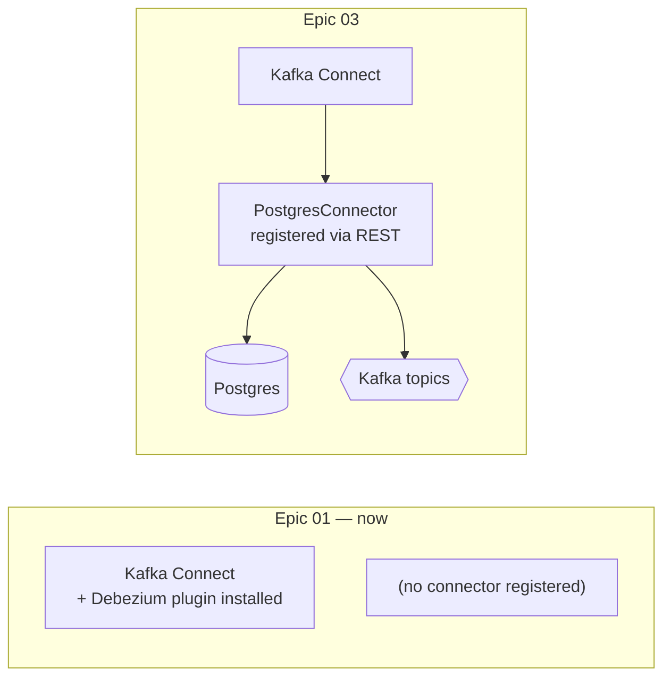

# Kafka Connect + Debezium

> **Status:** Connect running; **connector not yet registered** (epic 03) · **Spec:**
> [ARCHITECTURE.md](../../ARCHITECTURE.md) §2, D2, D6 · **REST:** <http://localhost:8083>

This is the **CDC producer** — the piece that actually turns Postgres's WAL into Kafka
events. It's two things stacked: **Kafka Connect** (a framework for running connectors) and
the **Debezium** Postgres connector (the plugin that knows how to read the WAL).

## What's running today vs. later

The compose stack runs **Kafka Connect with the Debezium plugin installed**, but **no
connector is configured yet** — registering the connector (with its table list, slot name,
and options) is [epic 03](../../project-mgmt/epic-03-cdc-ingestion/). Today, story 01.3's
smoke test only asserts the plugin is present:

```bash
curl -s http://localhost:8083/connector-plugins | jq -r '.[].class' | grep postgresql
# → io.debezium.connector.postgresql.PostgresConnector
```



## How Debezium captures changes: snapshot, then stream

When the connector is registered, it runs in two phases:


1. **Initial snapshot** — reads the current contents of the captured tables and emits them as
   events, so a brand-new consumer starts from a complete picture, not just future changes.
2. **Streaming** — from then on it tails the WAL through a **replication slot**, emitting each
   row change. The slot is the sharp edge (it pins WAL — see
   [Postgres & CDC](postgres-and-cdc.md#the-replication-slot-the-sharp-edge)).

## The event, and two decisions baked into it

Each event is JSON describing one row change: `op` (`c`/`u`/`d`/`r`), `before`/`after` row
images, and a `source` block that includes the **`lsn`** — the WAL position that every
consumer uses as its idempotency version.

Two connector decisions from the [decision log](../../ARCHITECTURE.md) matter to everyone
downstream:

- **[D6] `decimal.handling.mode=string`.** Postgres `NUMERIC` (`volume_ul`) must *not* become
  a lossy JSON float. Debezium emits it as a string; consumers parse it. In a genomics lab,
  aliquot-volume fidelity is a data-integrity concern — this is a classic CDC gotcha kept
  deliberately visible.
- **Tombstones on delete** (`tombstones.on.delete=true`). A delete emits both a delete event
  *and* a null-valued tombstone, which lets Kafka compaction eventually drop the key. See
  [Kafka compaction](kafka.md#log-compaction-bounded-but-never-forgets-current-state).

We also run **Debezium JSON without a schema registry / Avro** ([ARCHITECTURE §9](../../ARCHITECTURE.md))
— for inspectability. You can read raw events in kafka-ui and understand them.

## Why Debezium first (and not forever)

[D2](../../ARCHITECTURE.md): Debezium is a battle-tested reference implementation. We learn
the Kafka wiring against something correct first — and in phase 2 it becomes the *oracle* for
a hand-written `pgoutput` connector, validated by diffing its output against Debezium's (see
[roadmap](../../project-mgmt/roadmap.md)).

## Connect's own state

Kafka Connect stores its config, offsets, and status in three internal Kafka topics
(`connect_configs`, `connect_offsets`, `connect_statuses`) — you'll see these in kafka-ui.
That's how a connector survives a Connect restart and resumes from its last acknowledged LSN
(which is also why **re-emission after restart is normal**, and why consumers must be
idempotent — [ARCHITECTURE §5, §8](../../ARCHITECTURE.md)).

## See also

- [Postgres & CDC](postgres-and-cdc.md) — where the WAL and replication slot come from
- [Apache Kafka](kafka.md) — the topics these events land in
- [Data lifecycle](../data-lifecycle.md) — the event's full journey to a search hit
