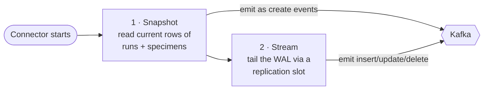

# Kafka Connect + Debezium

> **Status:** Connect running; **connector registered** (story 03.1 — `make connector`) ·
> **Spec:** [ARCHITECTURE.md](../../ARCHITECTURE.md) §2, D2, D6 · **REST:** <http://localhost:8083>

This is the **CDC producer** — the piece that actually turns Postgres's WAL into Kafka
events. It's two things stacked: **Kafka Connect** (a framework for running connectors) and
the **Debezium** Postgres connector (the plugin that knows how to read the WAL).

## The connector: config, registration, operations

The connector is a flat JSON config map at
[`deploy/connectors/genomics.json`](../../deploy/connectors/genomics.json), with every field
justified line-by-line in the adjacent
[`genomics.notes.md`](../../deploy/connectors/genomics.notes.md). Credentials are `${VAR}`
placeholders filled from the repo-root `.env` at registration time — nothing hardcoded.

```bash
make connector          # idempotent PUT /connectors/genomics/config (create or update)
make connector-status   # connector + task state (RUNNING when healthy)
make slot-status        # the Postgres replication slot: active + confirmed_flush_lsn + retained WAL
make connector-delete   # remove the connector (the slot survives — see the notes file)
```

`make connector` is idempotent by construction: Connect's `PUT …/config` creates the
connector if absent and updates it in place if present, so re-running never errors.

## Verification runbook (story 03.1 acceptance)

From a clean stack, this walks the full handshake and each acceptance criterion:

```bash
make nuke up seed        # fresh stack + schema + publication cdc_pub + 5,000 specimens
make connector           # register; snapshot begins immediately
make connector-status    # → connector=RUNNING tasks=[RUNNING]
```

1. **Snapshot** — open kafka-ui (<http://localhost:8080>) → topic `cdc.public.specimens`.
   Every seeded row is there as an `op:"r"` event (5,000 of them); `cdc.public.runs` has the
   ~30 runs. `r` = *read* (snapshot), not create.
2. **Streaming** — `make load` in one terminal; watch new `op:"c"/"u"/"d"` events appear live
   in kafka-ui within ~1s, correctly keyed by primary key (`{"id": …}`). Or drive one change
   by hand through the API (<http://localhost:8000/docs>) — an INSERT/UPDATE/DELETE each
   produce a visible event; a DELETE also emits a `null` tombstone on the same key.
3. **Slot** — `make slot-status` shows `cdc_genomics` with `active=t` and a
   `confirmed_flush_lsn` that advances as events are acknowledged (run it again under
   `make load` to watch it climb). Column-by-column reading:
   [learning 05](../../learnings/05-cdc-handshake-and-slots.md).

The same three checks are automated in `tests/smoke/test_cdc_connector.py` (`make smoke`).
Concept-level walkthrough of the whole handshake:
[learning 05](../../learnings/05-cdc-handshake-and-slots.md).

## How Debezium captures changes: snapshot, then stream

When the connector is registered, it runs in two phases:



1. **Initial snapshot** — reads the current contents of the captured tables and emits them as
   events, so a brand-new consumer starts from a complete picture, not just future changes.
2. **Streaming** — from then on it tails the WAL through a **replication slot**, emitting each
   row change. The slot is the sharp edge (it pins WAL — see
   [Postgres & CDC](postgres-and-cdc.md#the-replication-slot-the-sharp-edge)).

## The event, and two decisions baked into it

Each event is JSON describing one row change: `op` (`c`/`u`/`d`/`r`), `before`/`after` row
images, and a `source` block that includes the **`lsn`** — the WAL position that every
consumer uses as its idempotency version. The full field-by-field contract — real captured
payloads for all five event kinds, plus the `REPLICA IDENTITY` and decimal-mode experiments —
is **[EVENTS.md](../EVENTS.md)** (story 03.2), and it is the bar phase 2's connector must
reproduce.

Two connector decisions from the [decision log](../../ARCHITECTURE.md) matter to everyone
downstream:

- **[D6] `decimal.handling.mode=string`.** Postgres `NUMERIC` (`volume_ul`) must *not* become
  a lossy JSON float. Debezium emits it as a string; consumers parse it. In a genomics lab,
  aliquot-volume fidelity is a data-integrity concern — this is a classic CDC gotcha kept
  deliberately visible.
- **Tombstones on delete** (`tombstones.on.delete=true`). A delete emits both a delete event
  *and* a null-valued tombstone, which lets Kafka compaction eventually drop the key. See
  [Kafka compaction](kafka.md#log-compaction-bounded-but-never-forgets-current-state).

We also run **Debezium JSON without a schema registry / Avro** ([ARCHITECTURE §9](../../ARCHITECTURE.md))
— for inspectability. You can read raw events in kafka-ui and understand them.

## Why Debezium first (and not forever)

[D2](../../ARCHITECTURE.md): Debezium is a battle-tested reference implementation. We learn
the Kafka wiring against something correct first — and in phase 2 it becomes the *oracle* for
a hand-written `pgoutput` connector, validated by diffing its output against Debezium's (see
[roadmap](../../project-mgmt/roadmap.md)).

## Connect's own state

Kafka Connect stores its config, offsets, and status in three internal Kafka topics
(`connect_configs`, `connect_offsets`, `connect_statuses`) — you'll see these in kafka-ui.
That's how a connector survives a Connect restart and resumes from its last acknowledged LSN
(which is also why **re-emission after restart is normal**, and why consumers must be
idempotent — [ARCHITECTURE §5, §8](../../ARCHITECTURE.md)).

## See also

- [EVENTS.md](../EVENTS.md) — the change-event contract: every field of every event kind
- [Postgres & CDC](postgres-and-cdc.md) — where the WAL and replication slot come from
- [Apache Kafka](kafka.md) — the topics these events land in
- [Data lifecycle](../data-lifecycle.md) — the event's full journey to a search hit
