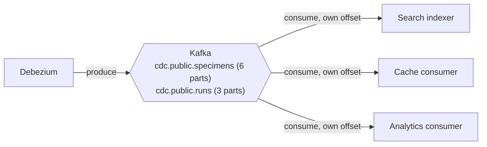
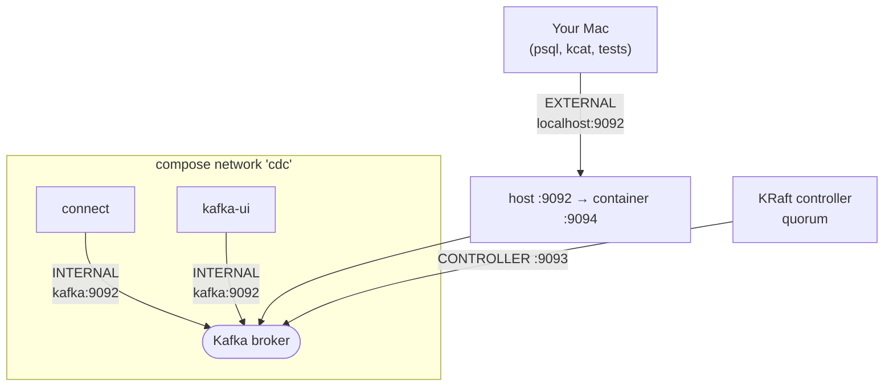
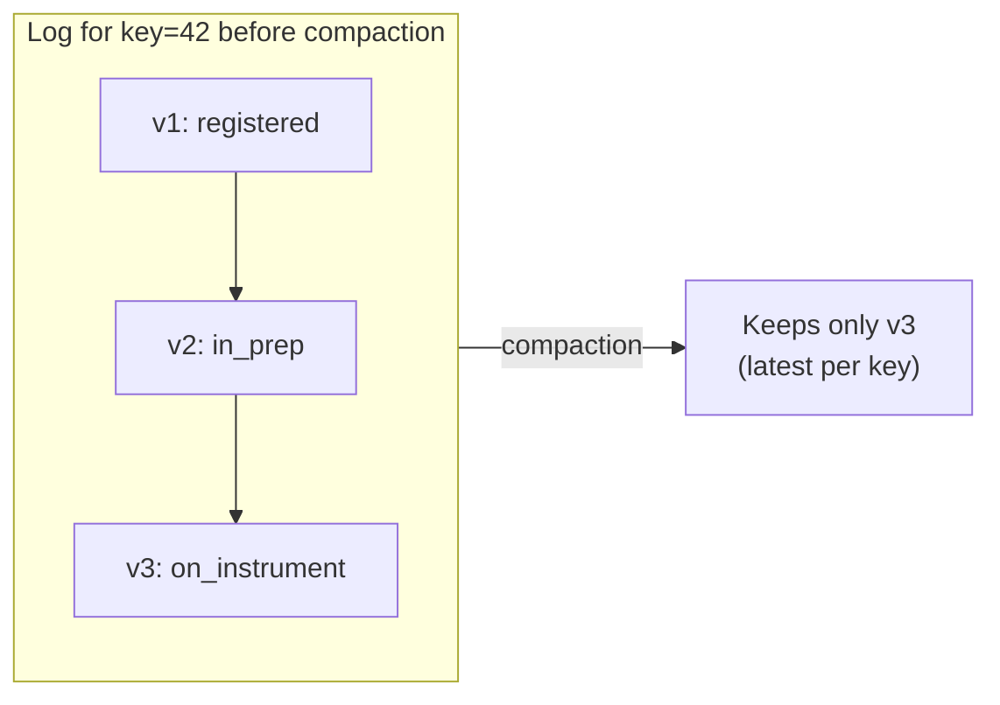

# Apache Kafka

> **Status:** running · topics designed and compacted (epic 03.3) · **Spec:** [ARCHITECTURE.md](../../ARCHITECTURE.md) §4, D1, D3 ·
> **Config:** [deploy/docker-compose.yml](../../deploy/docker-compose.yml) · **UI:** <http://localhost:8080>

Kafka is the **durable, ordered, replayable log** at the centre of the system. Debezium
writes row changes into it; every derived store reads them out independently and at its own
pace. It is the buffer that decouples the one producer from the many consumers.

## Role

Each consumer group has its **own position** in the log, so a slow or newly-added consumer
never affects the others — that independence is what lets us add the analytics consumer
later with zero producer changes, and what makes replay possible.

## Single node, KRaft mode (no ZooKeeper)

We run one Kafka node in **KRaft mode**, where the same process is both **broker** (serves
data) and **controller** (manages cluster metadata) — no separate ZooKeeper ensemble, which
is how modern Kafka runs. It's the deliberately boring, industry-standard choice
([D1](../../ARCHITECTURE.md)); we learn its real operational surface (`kafka-*.sh`,
`kafka-consumer-groups.sh`, `kcat`) rather than a friendlier reimplementation.

### Listeners: how you and the containers reach the broker

The trickiest bit of a Dockerised Kafka is that clients *inside* the compose network and
clients on *your Mac* need different addresses. We define two:

- **INTERNAL** (`kafka:9092`) — used by `connect` and `kafka-ui` within the Docker network.
- **EXTERNAL** (`localhost:9092`, mapped to container `9094`) — used by tooling on the host.
- **CONTROLLER** (`9093`) — the KRaft metadata quorum, internal only.

Getting `advertised.listeners` wrong here is the classic "works inside Docker, refuses from
the host" Kafka trap; the split above is why both work.

## Topics and partitioning

The data topics are **created explicitly** by `make topics` from
[`deploy/topics/topics.json`](../../deploy/topics/topics.json) (story 03.3) — never by the
broker. `auto.create.topics.enable` is **off**, because an auto-created topic gets one
partition and a 7-day delete policy, and neither failure is visible until the day it
matters. Their design is fixed by [ARCHITECTURE.md §4](../../ARCHITECTURE.md):

| Topic | Key | Partitions | Cleanup |
|---|---|---|---|
| `cdc.public.specimens` | specimen id | 6 | `compact` |
| `cdc.public.runs` | run id | 3 | `compact` |
| `<consumer>.dlq` | original key | 1 | `delete` (30d) |

- **Key = primary key.** All changes to one row hash to the same partition, so **per-row
  ordering is guaranteed**. Cross-row and cross-table ordering is *not* — and consumers must
  never assume it (this is exactly what bites the search indexer's run/specimen join, §7).
- **6 partitions** on specimens is deliberate slack — enough to demonstrate multi-instance
  consumer scaling and rebalancing, not a capacity plan.
- **Partition counts are effectively immutable.** Kafka will let you grow one; don't.
  `partition = murmur2(key) % n`, so changing `n` re-hashes the key space — a row's old
  records stay put while its new ones route elsewhere, leaving two "latest" values that
  compaction can never merge and per-key ordering silently broken. `cdc-topics create`
  refuses the operation; `make topics-recreate` deletes and rebuilds instead.

Inspect the live topics two ways: `make topics-describe` runs Kafka's own
`kafka-topics.sh --describe` (the operational surface [D1](../../ARCHITECTURE.md) says to
learn) and then `cdc-topics describe`, which adds a drift verdict against the committed spec.
The seeded 5 000 specimens landed 846/819/845/830/816/844 across the six partitions.

## Log compaction: bounded, but never forgets current state

Compaction keeps the **latest event per key forever** while dropping superseded ones, so the
log stays bounded but still contains everything needed to rebuild a read-model (which is a
function of *current* row state, not history — [D3](../../ARCHITECTURE.md)). Debezium's
tombstones (`tombstones.on.delete=true`) let compaction eventually drop deleted keys
entirely. This is precisely why **replay from offset 0 is cheap** — the payoff in epic 06.

> Trade-off ([D3](../../ARCHITECTURE.md)): replay reconstructs *state*, not full change
> *history*. A consumer needing an audit log would use `delete`-policy topics with long
> retention — a different project (see [ARCHITECTURE §0](../../ARCHITECTURE.md)).

Compaction also makes the log **non-contiguous**: a surviving record keeps its original
offset, so reading a partition start-to-end returns fewer records than `high − low`. In the
story 03.3 demo, 1 000 updates to one specimen went from 1 001 records to **1** in 15 s, and
that partition dropped from 1 875 to 850 readable records over the same 2 000-odd offsets.

### Why it looks like compaction isn't running

A record is cleaned only after passing three gates, and on a quiet lab topic all three are
shut. The cleaner never touches the **active segment**, and a segment only rolls when a
record arrives after `segment.ms` (**default 7 days**); the partition must also be dirtier
than `min.cleanable.dirty.ratio` (**default 0.5**); and tombstones additionally wait out
`delete.retention.ms` (**default 24 h**). We lower all of these so a demo finishes in
minutes — lab settings, not recommendations, itemised in
[`deploy/topics/topics.notes.md`](../../deploy/topics/topics.notes.md) and explained in
[learning 06](../../learnings/06-kafka-topic-design-and-compaction.md).

### The tombstone's two-stage death

A hard delete leaves two records on the key: the `op:"d"` event (for consumers) and a
null-valued tombstone (for compaction). Stage one compacts the delete event away and keeps
the tombstone; stage two, only after `delete.retention.ms`, removes the tombstone and the
key leaves the log entirely. That second delay is the window an offline consumer has to
learn about the delete — observed at 60 s and a further 75 s in the story 03.3 demo.

## kafka-ui

Apache Kafka ships no console, so [kafka-ui](http://localhost:8080) gives us a browser view
of brokers, topics, messages, consumer-group lag, and the Connect cluster — change events
land there in real time from epic 03 onwards.

## Config reference

| Setting | Value | Why |
|---|---|---|
| Host port | `9092` → container `9094` | EXTERNAL listener for host tooling |
| Replication factor | `1` | single node — a lab, never prod |
| `CLUSTER_ID` | fixed in compose | reproducible format across rebuilds |
| `auto.create.topics.enable` | `false` | Topics are designed, not defaulted (story 03.3). A missing topic becomes a loud connector failure instead of a silently mis-shaped one. |

> **One engine at a time.** Running Colima and Docker Desktop together publishes `9092`
> twice (one on IPv4, one on IPv6) and `localhost` resolves to both — so host-side clients
> alternate between *two different clusters*. See
> [ADR 0002](../adr/0002-colima-over-docker-desktop.md); diagnose with
> `lsof -nP -iTCP:9092 -sTCP:LISTEN`.

## See also

- [System overview](../overview.md) · [Data lifecycle](../data-lifecycle.md)
- [Kafka Connect + Debezium](kafka-connect-debezium.md) — the producer feeding these topics
- [`deploy/topics/topics.notes.md`](../../deploy/topics/topics.notes.md) — every topic setting, one line each
- [Learning 06](../../learnings/06-kafka-topic-design-and-compaction.md) — partitions, the three compaction gates, and the `run_id` re-keying thought experiment
