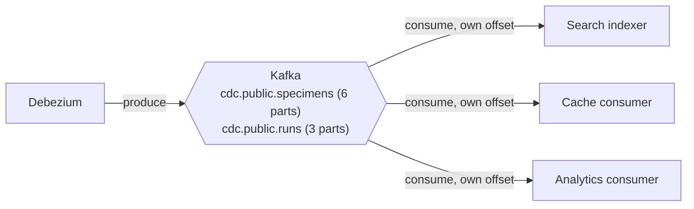
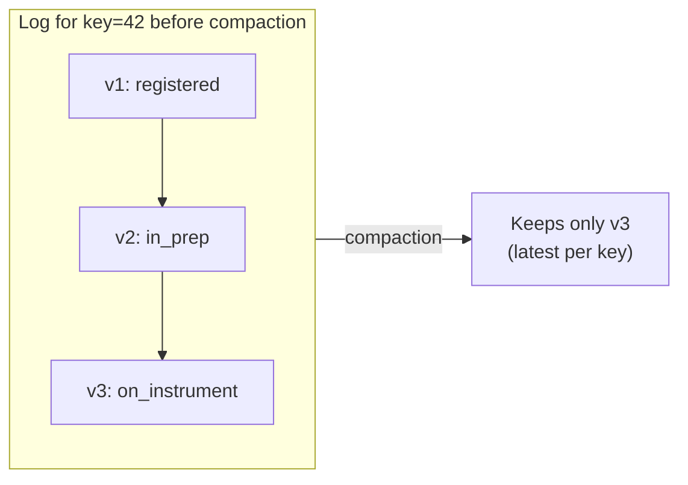

# Apache Kafka

> **Status:** running (epic 01) · **Spec:** [ARCHITECTURE.md](../../ARCHITECTURE.md) §4, D1 ·
> **Config:** [deploy/docker-compose.yml](../../deploy/docker-compose.yml) · **UI:** <http://localhost:8080>

Kafka is the **durable, ordered, replayable log** at the centre of the system. Debezium
writes row changes into it; every derived store reads them out independently and at its own
pace. It is the buffer that decouples the one producer from the many consumers.

## Role

Each consumer group has its **own position** in the log, so a slow or newly-added consumer
never affects the others — that independence is what lets us add the analytics consumer
later with zero producer changes, and what makes replay possible.

## Single node, KRaft mode (no ZooKeeper)

We run one Kafka node in **KRaft mode**, where the same process is both **broker** (serves
data) and **controller** (manages cluster metadata) — no separate ZooKeeper ensemble, which
is how modern Kafka runs. It's the deliberately boring, industry-standard choice
([D1](../../ARCHITECTURE.md)); we learn its real operational surface (`kafka-*.sh`,
`kafka-consumer-groups.sh`, `kcat`) rather than a friendlier reimplementation.

### Listeners: how you and the containers reach the broker

The trickiest bit of a Dockerised Kafka is that clients *inside* the compose network and
clients on *your Mac* need different addresses. We define two:

- **INTERNAL** (`kafka:9092`) — used by `connect` and `kafka-ui` within the Docker network.
- **EXTERNAL** (`localhost:9092`, mapped to container `9094`) — used by tooling on the host.
- **CONTROLLER** (`9093`) — the KRaft metadata quorum, internal only.

Getting `advertised.listeners` wrong here is the classic "works inside Docker, refuses from
the host" Kafka trap; the split above is why both work.

## Topics and partitioning

The real data topics are created by Debezium in epic 03; their design is fixed here
([ARCHITECTURE.md §4](../../ARCHITECTURE.md)):

| Topic | Key | Partitions | Cleanup |
|---|---|---|---|
| `cdc.public.specimens` | specimen id | 6 | `compact` |
| `cdc.public.runs` | run id | 3 | `compact` |
| `<consumer>.dlq` | original key | 1 | `delete` (30d) |

- **Key = primary key.** All changes to one row hash to the same partition, so **per-row
  ordering is guaranteed**. Cross-row and cross-table ordering is *not* — and consumers must
  never assume it (this is exactly what bites the search indexer's run/specimen join, §7).
- **6 partitions** on specimens is deliberate slack — enough to demonstrate multi-instance
  consumer scaling and rebalancing, not a capacity plan.

## Log compaction: bounded, but never forgets current state

Compaction keeps the **latest event per key forever** while dropping superseded ones, so the
log stays bounded but still contains everything needed to rebuild a read-model (which is a
function of *current* row state, not history — [D3](../../ARCHITECTURE.md)). Debezium's
tombstones (`tombstones.on.delete=true`) let compaction eventually drop deleted keys
entirely. This is precisely why **replay from offset 0 is cheap** — the payoff in epic 06.

> Trade-off ([D3](../../ARCHITECTURE.md)): replay reconstructs *state*, not full change
> *history*. A consumer needing an audit log would use `delete`-policy topics with long
> retention — a different project (see [ARCHITECTURE §0](../../ARCHITECTURE.md)).

## kafka-ui

Apache Kafka ships no console, so [kafka-ui](http://localhost:8080) gives us a browser view
of brokers, topics, messages, consumer-group lag, and the Connect cluster. Today it's nearly
empty (only Connect's internal `connect_*` topics); from epic 03 you'll watch change events
land here in real time.

## Config reference

| Setting | Value | Why |
|---|---|---|
| Host port | `9092` → container `9094` | EXTERNAL listener for host tooling |
| Replication factor | `1` | single node — a lab, never prod |
| `CLUSTER_ID` | fixed in compose | reproducible format across rebuilds |

## See also

- [System overview](../overview.md) · [Data lifecycle](../data-lifecycle.md)
- [Kafka Connect + Debezium](kafka-connect-debezium.md) — the producer feeding these topics
