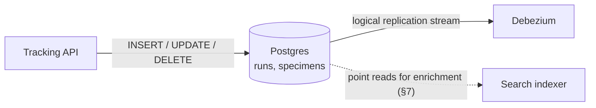
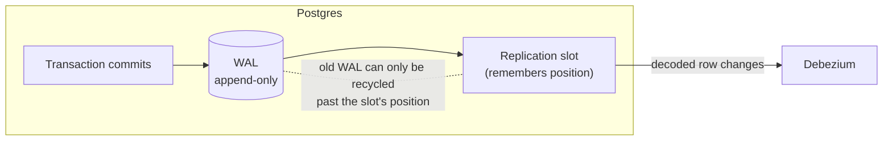
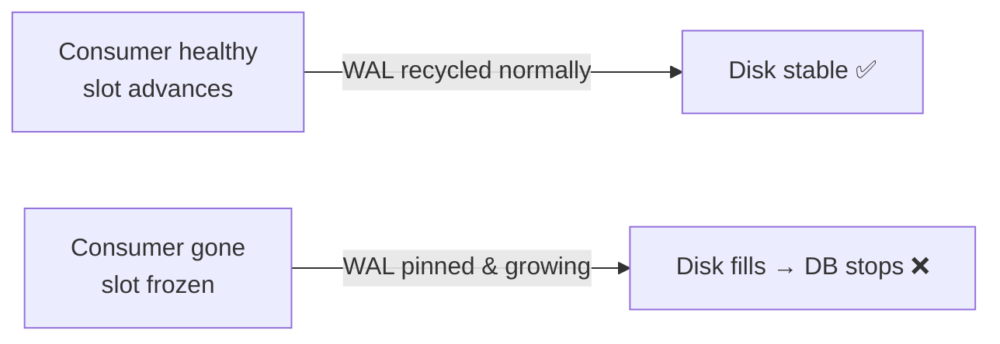

# Postgres & CDC

> **Status:** running (epic 01) · **Spec:** [ARCHITECTURE.md](../../ARCHITECTURE.md) §2, D4 ·
> **Gotcha notes:** [learnings/01](../../learnings/01-postgres-logical-replication.md) ·
> **Config:** [deploy/docker-compose.yml](../../deploy/docker-compose.yml)

Postgres is the **source of truth** — the one store the application writes to. Everything
else in the system is derived from the change stream Postgres emits. This page explains how
a plain relational database becomes a change *producer*, and what that costs.

## The role: write path only



Postgres does two jobs and refuses a third:

- ✅ It is the transactional system of record for `runs` and `specimens`.
- ✅ It **emits** a logical replication stream that Debezium consumes.
- ❌ It is *not* responsible for anything derived — no search, no cache, no fan-out logic.

## How a database becomes a change stream

Every change to Postgres is written to the **Write-Ahead Log (WAL)** before the table files
are touched — that's how it survives crashes. Change Data Capture piggybacks on this: rather
than polling tables or bolting on triggers, Debezium *reads the WAL* and turns each recorded
row change into an event. The database's own durability log becomes our change stream.



But a default Postgres doesn't record *enough* in the WAL to reconstruct row-level changes,
and it won't hand out a logical stream at all. Two settings fix that — the crux of this
whole page.

### 1. `wal_level = logical` (server-wide, set in compose)

The WAL has levels of detail. The default, `replica`, records enough to ship the WAL
byte-for-byte to a physical standby — but a physical standby can't answer "*which rows
changed?*". `logical` adds the metadata needed to **decode** the WAL into row-level events
(`INSERT id=42…`, `UPDATE…`, `DELETE…`), independent of on-disk layout. That decoded stream
is exactly what Debezium consumes.

It's server-wide and needs a restart, so it lives in the compose file from day one:

```yaml
command:
  - "postgres"
  - "-c"
  - "wal_level=logical"
  - "-c"
  - "max_wal_senders=8"       # ≥4 — WAL sender processes (Debezium uses one)
  - "-c"
  - "max_replication_slots=8" # ≥4 — slots are a finite server resource
```

Verify on the running stack:

```bash
docker compose --env-file .env -f deploy/docker-compose.yml \
  exec -T postgres psql -U cdc -d genomics -tAc "SHOW wal_level;"   # → logical
```

Without this, creating a logical replication slot fails and the Debezium connector (epic 03)
never starts. It is the one non-negotiable CDC setting.

### 2. `REPLICA IDENTITY FULL` (per-table, set in epic 02/03)

This decides how much of the **old** row Postgres logs on an `UPDATE`/`DELETE`. The default
logs only the primary key; `FULL` logs the **entire before-image**. We choose `FULL`
(decision [D4](../../ARCHITECTURE.md)) so the verifier and consumers get complete old-row
data and deletes are self-describing. The cost is honest: more WAL volume. There are no
tables yet, so it's applied when the schema lands:

```sql
ALTER TABLE specimens REPLICA IDENTITY FULL;
ALTER TABLE runs      REPLICA IDENTITY FULL;
```

Full explanation of both settings — including the table of `wal_level` and
`REPLICA IDENTITY` options — is in [learnings/01](../../learnings/01-postgres-logical-replication.md).

## The replication slot: the sharp edge

A **replication slot** is how Postgres remembers how far a consumer (Debezium) has read. It
is a *first-class, finite server resource*, and it has a dangerous property:

> Postgres **cannot recycle WAL past a slot's position.** A slot is a promise to keep that
> WAL around until it's consumed. If the consumer disappears and the slot is left behind, the
> WAL grows without bound — **until the disk fills and the database stops.**

This is the classic CDC production incident. Our answer (drilled in epic 03) is a slot-lag
watchdog plus a runbook. It's called out here because it's the failure mode that most often
bites teams new to CDC — see [ARCHITECTURE.md §8](../../ARCHITECTURE.md).



## Data model (what's being captured)

```
runs(id PK, run_code UNIQUE, assay_protocol, sequencer, operator, status, updated_at)
specimens(id PK, barcode UNIQUE, label, description, specimen_type, assay,
          volume_ul NUMERIC(10,2), status, run_id FK, updated_at)
```

Two details that matter downstream:

- **`volume_ul` is `NUMERIC(10,2)`**, not a float — aliquot volumes are precise decimals, and
  turning them into lossy JSON floats is a real data-integrity bug. It forces the
  decimal-handling decision ([D6](../../ARCHITECTURE.md): Debezium `decimal.handling.mode=string`).
- **`status` transitions drive the projection-delete rules** (a `disposed` specimen is soft-
  deleted from the search index though its row survives) — see [data lifecycle](../data-lifecycle.md).

Full schema rationale and the "three deliberate sources of difficulty" are in
[ARCHITECTURE.md §3](../../ARCHITECTURE.md).

## See also

- [System overview](../overview.md) · [Data lifecycle](../data-lifecycle.md)
- [learnings/01 — logical replication settings](../../learnings/01-postgres-logical-replication.md)
- [ADR-0001 — named volumes for Postgres storage](../adr/0001-postgres-storage-named-volumes.md)
