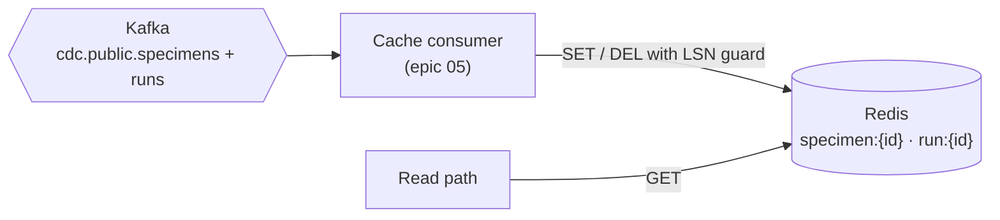
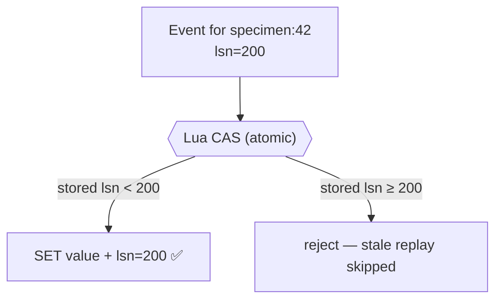

# Redis

> **Status:** running; **empty until the cache consumer lands** (epic 05) · **Spec:**
> [ARCHITECTURE.md](../../ARCHITECTURE.md) §2, §5 · **CLI:** `redis-cli -p 6379`

Redis is the **cache read-model** — fast point reads of run and specimen metadata for
accessioning screens and queue dashboards, so those high-frequency lookups never hit
Postgres.

## Role



Like Elasticsearch, Redis is populated **only** by its consumer reading Kafka — never written
by the application. Today it's up and healthy but empty; the cache consumer arrives in
[epic 05](../../project-mgmt/epic-05-cache-consumer/).

```bash
docker compose --env-file .env -f deploy/docker-compose.yml exec -T redis redis-cli ping  # → PONG
```

## Idempotency: compare-and-set on the LSN

Same at-least-once reality as everywhere else — the cache consumer will see duplicates and
out-of-order replays. Elasticsearch got idempotency for free via external versioning; Redis
has no such built-in, so we implement the **same guard by hand** with a Lua compare-and-set
script that runs atomically on the server:



Each value is stored alongside the LSN of the event that produced it; a write only lands if
its LSN is **greater** than the stored one. Deletes use the same guard (CAS-delete). Doing
this in a Lua script matters — it makes the read-check-write a single atomic operation, so two
consumer instances can't race. See
[data lifecycle](../data-lifecycle.md#why-duplicates-are-normal-and-fine).

## Key model

Point-read shaped: `specimen:{id}` and `run:{id}` holding the metadata each screen needs.
(Exact fields are settled in epic 05.) This is a cache of **current state**, rebuildable from
the log like every other derived store — not a source of truth.

## Parity with the source

The cache consumer's job is to keep Redis in agreement with Postgres; the **verifier**
([epic 06](../pipeline/verifier-and-replay.md)) diffs Redis against Postgres by key and
content hash, so "the cache is correct" is a program's verdict, not an assumption.

## See also

- [Cache consumer](../pipeline/cache-consumer.md) — the consumer that populates this store
- [Elasticsearch](elasticsearch.md) — the other derived store, same idempotency idea
- [Data lifecycle](../data-lifecycle.md) · [System overview](../overview.md)
