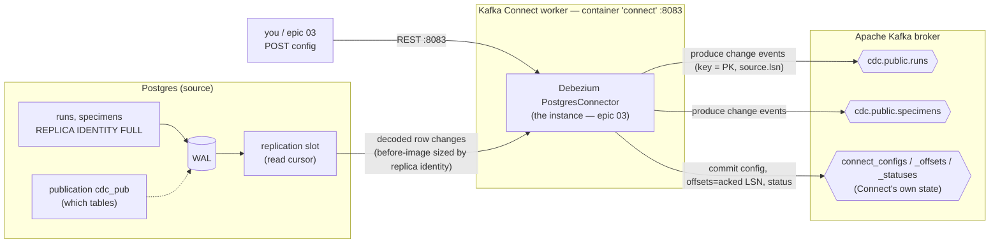

# 03 — Kafka connectors, and how Debezium is fed by Postgres

*Context: follow-up to story 02.1, from the question "is there even a Debezium container,
and how does it consume the replica identity?" This note is the concept layer: what a Kafka
**connector** actually is, why Debezium isn't a standalone daemon, and the two interfaces a
source connector has — the one facing Postgres (how it's *fed*) and the one facing Kafka
(how it *interacts* with the broker). For the connector's config options and event fields,
see the platform page [Kafka Connect + Debezium](../docs/platform/kafka-connect-debezium.md);
for the Postgres settings underneath, [learnings 01](01-postgres-logical-replication.md) and
[02](02-publications-and-capture-config.md).*

## What is a Kafka connector?

**Kafka Connect** is a runtime for moving data in and out of Kafka *without writing a bespoke
producer or consumer*. Instead of coding "read from X, produce to Kafka," you install a
plugin and hand Connect a JSON config; it runs the data movement, restarts, retries, and
offset-tracking for you. It splits into two families:

- **Source connector** — pulls from an external system *into* Kafka (Debezium's
  `PostgresConnector` is one: Postgres → Kafka).
- **Sink connector** — pushes *from* Kafka into an external system (e.g. an Elasticsearch
  sink connector). We don't use a sink connector — our consumers (epics 04–05) are
  hand-written Python for full control — but the category is the mirror image.

Three words that are easy to conflate:

| Term | What it is | In our stack |
|---|---|---|
| **Worker** | the Connect JVM process (the container) | the `connect` service, REST on :8083 |
| **Connector plugin** | installed code that *knows how* to talk to a system | `io.debezium.connector.postgresql.PostgresConnector` (baked into the image) |
| **Connector instance** | a *configured, running* job you create via REST | none yet — created in epic 03 |
| **Task** | a unit of the instance's work, for parallelism | 1 (Postgres logical replication is single-stream) |

This is the crux of the earlier confusion: **Debezium is not a standalone service with its
own port.** It's a *plugin running inside a Kafka Connect worker*. "Is there a Debezium
container?" → yes, but it's named `connect` (image `debezium/connect`), and what you POST to
on **:8083** is Kafka Connect's REST control plane. Right now the plugin is *installed* but no
instance is *registered* — `GET /connectors` returns `[]`.

## How the connector is fed from Postgres

A Debezium source connector is, underneath, an ordinary **logical replication client** — the
same role a Postgres read-replica would play. It doesn't poll tables or run triggers. When
registered (epic 03) it:

1. Creates (or reuses) a **replication slot** — its private cursor into the WAL. The slot is
   what makes the stream resumable, and it's the sharp edge that pins WAL until consumed
   ([learning 01](01-postgres-logical-replication.md)).
2. Reads only the tables in the **publication** `cdc_pub` ([learning 02](02-publications-and-capture-config.md)).
3. Does an **initial snapshot** (current rows, emitted as `op:"r"` events) so a new consumer
   starts from a full picture, then **streams** WAL changes forever after.

Note that the **slot and the publication are two separate knobs of the same stream, not one
nested in the other**: the slot is Debezium's *position/cursor* (where it's reading from, and
a promise to Postgres to keep that WAL), while the publication is a *filter* passed as an
option on that stream (which tables' changes come down it). One publication can serve many
consumers; each consumer has its own slot. Details in [learning 02](02-publications-and-capture-config.md).

### `REPLICA IDENTITY` is a *table property*, and it sizes each event

The third knob is per-table and different in kind from the other two. `REPLICA IDENTITY` is a
property **stored on the table in the Postgres catalog** (visible as `relreplident` in
`pg_class`), set once with DDL:

```sql
ALTER TABLE specimens REPLICA IDENTITY FULL;   -- relreplident: 'd' (default) → 'f' (full)
```

It controls exactly one thing: **how much of the OLD row Postgres writes to the WAL for an
`UPDATE` or `DELETE`** (the "before-image"). It is not something Debezium sets or reads at
runtime — it changes what is *physically in the WAL* before Debezium ever gets there:

| Setting | Old-row data in the WAL | So the event's `before` block is… |
|---|---|---|
| `DEFAULT` | primary key only | `{ id: 42 }` |
| `USING INDEX x` | a chosen unique index's columns | those columns |
| `NOTHING` | nothing | absent (UPDATE/DELETE can't be logically replicated) |
| **`FULL`** (our choice, D4) | **every column of the old row** | `{ id: 42, barcode: "SPEC-000042", status: "in_prep", … }` |

Postgres decodes each WAL record into a row change and hands it to the connector; the
connector can only build a `before` image as complete as replica identity made the WAL. So
the three Postgres-side knobs line up cleanly:

- **publication** = *which* tables are captured (declarative, shared, catalog)
- **replication slot** = *how far* this consumer has read (positional, per-consumer, pins WAL)
- **replica identity** = *how complete* each event is (a table property, sizes the before-image)

We pay for `FULL` in WAL volume (every UPDATE/DELETE logs the whole old row), and buy
self-describing deletes and a before/after the verifier can diff — decision D4, full
treatment in [learning 01](01-postgres-logical-replication.md).

## How the connector interacts with Kafka

The connector talks to the broker in **two distinct roles**, which is the part that surprises
people:

1. **Data plane — it's a producer.** Each row change becomes a message on a change topic,
   keyed by primary key: `cdc.public.runs`, `cdc.public.specimens`. Every event carries a
   `source.lsn` (its WAL position), which every downstream consumer uses as an idempotency
   version ([data lifecycle](../docs/data-lifecycle.md)).
2. **Control/state plane — Connect stores its *own* state in Kafka too.** The worker keeps
   connector config, committed **offsets**, and status in three internal topics
   (`connect_configs`, `connect_offsets`, `connect_statuses`). The "offset" for a Debezium
   source is the **LSN it has acknowledged**. That's how a connector survives a restart and
   resumes — and also *why re-emission after a restart is normal*, and therefore why every
   consumer must be idempotent (at-least-once, ARCHITECTURE §5).



## Takeaway

- A **connector** = a Connect **plugin** (installed know-how) + a **configured instance** (a
  running job created via REST). **Source** connectors feed Kafka; **sink** connectors drain it.
- **Debezium is a source-connector plugin inside Kafka Connect**, not its own daemon. The
  container is `connect`; the REST API is `:8083`; today the plugin is installed but no
  instance is registered (`GET /connectors` → `[]`).
- **Fed from Postgres** as a logical-replication client: slot (cursor) + publication (which
  tables), snapshot then stream. `REPLICA IDENTITY FULL` decides how complete the `before`
  image in each event is.
- **Interacts with Kafka in two roles:** produces change events to the `cdc.public.*` topics,
  *and* stores its own config/offset(=LSN)/status in internal Kafka topics — which is what
  makes it resumable and re-emission (hence at-least-once) normal.
